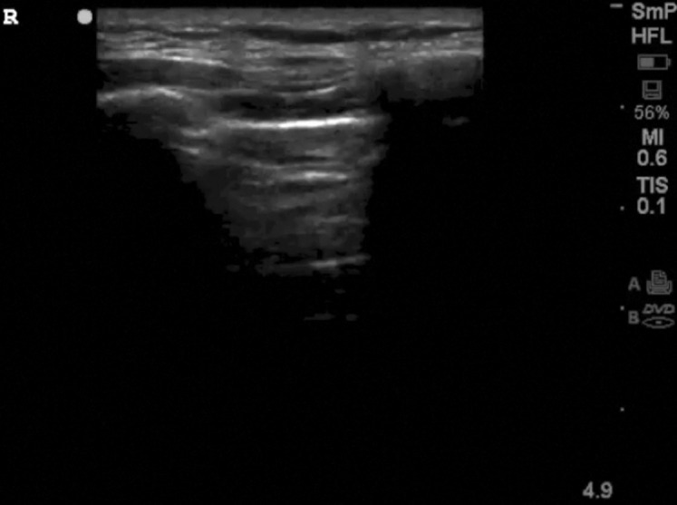
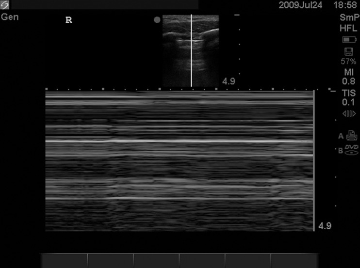
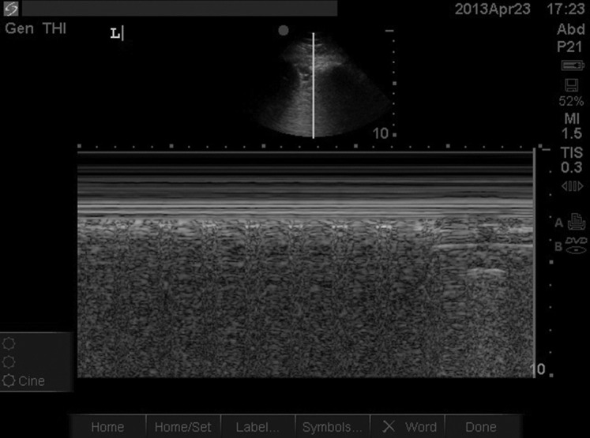
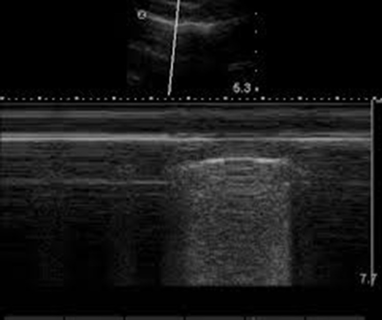

One of the chief presenting complaints in the emergency department is dyspnea. The review article in question instructs clinicians on how to evaluate dyspnea and its etiology[^ref-dyspnea]. The first half explains the evaluation of an undifferentiated patient using diagnostic tests, including the physical exam; the latter half explains etiology using four major categories: obstructive, parenchymal, cardiac, and compensatory.

The article begins by using a machine as an analogy for the dysfunctional respiratory system, in which one—or several—of the following components may malfunction: controllers, ventilatory pumps, and gas exchangers. A patient, upon evaluation, may be found to have metabolic acidosis[^acidosis], increasing their respiratory rate to compensate for low blood pH (controller); a patient's diaphragm may be paralyzed[^Guillain-Barre], preventing a normal breathing pattern (ventilatory pump); or a patient may be unable to effectively exchange O₂ and CO₂ between the alveoli and pulmonary capillaries (gas exchanger). A faulty controller often involves abnormal feedback to the brain from other parts of the system; the ventilatory pump refers to the mechanics of inspiration and expiration; and a fault in the gas-exchange system is often the result of a disruption of the interface between the pulmonary capillaries and alveoli. As examined later, obstructive, parenchymal, cardiac, and compensatory aberrations often take one of these three paths in causing acute dyspnea.

### Evaluation

DeVos and Jacobson argue for the use of ultrasonography as an early diagnostic tool, among other clues, of course, like history and physical examination. They reference the Bedside Lung Ultrasonography in Emergency (BLUE) protocol. Crucially, using BLUE is not the same as asking which of the four major categories of dyspnea the patient falls into. For instance, one wouldn't be able to detect acidosis with an ultrasound. To complement BLUE, other tests, a thorough history, and a physical examination are all necessary. I will not go into these because there's far too much material to cover.

Below are some of the still frames I was able to interpret. The remaining figures (there are nine in total) are all optical abstractions that make absolutely no sense to me.

This is a normal lung in which ultrasound waves reflect at increasingly deeper interfaces, getting fainter as they go.

This still frame was taken in M-mode[^m-mode] while the patient was breathing. Normally, the visceral pleura moves against the parietal pleura, sliding across the surface as one breathes—unless air enters the space between the two membranes, the pleural cavity. The air consequently separates the two membranes, preventing any motion from being detected and resulting in the static A-lines shown. In pneumothorax, you wouldn't see lung sliding.

On the other hand, in a normal lung, with the parietal and visceral pleura in contact with each other, the following image shows lung sliding.

Sometimes, pneumothorax creates a region where the visceral and parietal pleura are separated by air, depending on the amount of air in the cavity. If the amount of air is relatively small, some of the visceral pleura may come into contact with the parietal pleura, resulting in the following image, with regions of no lung sliding (stratosphere or barcode pattern) and lung sliding (seashore pattern).

### Etiology

**Obstructive Dyspnea** may result from the following general causes: inflammation (anaphylaxis), secretions, or foreign bodies. Inspiratory stridor can often be the result of an upper respiratory obstruction, seen in cases such as asthma. Epinephrine, fluid boluses, antihistamines, steroids, BiPAP ventilation, nebulized albuterol, and intravenous magnesium may be administered[^dyspneic-medications].

The review then describes **Parenchymal Dyspnea**, particularly cases caused by congestive heart failure (CHF) and pneumonia. CHF may cause pulmonary edema via hypertension in the pulmonary veins, leading to impaired gas exchange and, hence, dyspnea. Pneumonia often introduces pulmonary infiltrates into the alveoli, decreasing oxygen diffusion alongside the classical symptoms that accompany infection. Antibiotic therapy then proceeds.

Most interestingly, **Circulatory Dyspnea** includes pulmonary embolism alongside acute coronary syndrome and the aforementioned pneumothorax. Pulmonary embolism causes right ventricular strain and, as a result, fluid backup and chest pain, with potential edema. Treatment of the embolism would entail anticoagulation for selected patients[^pulmonary-embolism].

**Compensatory Dyspnea**, as expounded upon in the footnotes, is metabolic in etiology, namely acidosis of various kinds.

[^ref-dyspnea]: DeVos, E., & Jacobson, L. (2016). Approach to Adult Patients with Acute Dyspnea. *Emergency Medicine Clinics of North America, 34*(1), 129–149. [https://doi.org/10.1016/j.emc.2015.08.008](https://doi.org/10.1016/j.emc.2015.08.008)

[^acidosis]: The review article, in one of its first patient history vignettes, presents a woman with diabetes, making diabetic ketoacidosis (DKA) a likely diagnosis among the differential diagnoses. Glucose assimilation is significantly inhibited (in T1DM, at least); hence, the patient must rely on ketogenesis for energy production. This produces several ketones, some of which are not inherently acidic, although most of the primary products are, namely acetoacetic acid and β-hydroxybutyric acid. This lowers blood pH by blowing off CO₂, aka HCO₃ in the blood. Importantly, this doesn't get rid of acetoacetic acid and β-hydroxybutyric acid. An increased respiratory rate is merely a compensatory measure to increase pH in spite of the acids present. This mechanism is broadly the same one we find in alcoholic acidosis (AA). Alcohol processing requires alcohol dehydrogenase in the liver, the enzyme that converts ethanol to acetate. This conversion requires an intermediate step. Ethanol must be converted to acetaldehyde first—and only then can it be turned into acetate (acetaldehyde is extremely toxic, even more so than ethanol; it is also one carbon away from formaldehyde, the compound used to preserve cadavers, and though one may argue that chemical alteration significantly changes biological activity, they look frighteningly similar. Acetaldehyde is also a carcinogen and the cause of hangovers. I find it ridiculous how pervasive the literature on beneficial alcohol consumption is because it isn't beneficial; no amount of alcohol is safe for you, and if you want to drink, there's absolutely nothing wrong with that because life is hard and we all need a break, but don't delude yourself into thinking some red wine will lead to a healthy heart). Both reactions—both of which are catalyzed by alcohol dehydrogenase—consume NAD⁺ and consequently increase NADH. An increase in the concentration of NADH favors the production of lactate over pyruvate, as predicted by Le Chatelier's Principle. Lactic acid then diffuses into systemic circulation, and the rest of the story follows from what precedes.

[^Guillain-Barre]: Neuromuscular problems may contribute to a faulty so-called pump, e.g., Guillain–Barré syndrome (GBS), an autoimmune disorder that, unlike most other autoimmune disorders (which involve a loss of immunological self-tolerance), is caused by something called molecular mimicry, resulting in demyelination of the peripheral nerves. Notably, during an infection caused by the enteric pathogen *Campylobacter jejuni*, the immune system produces antibodies against lipooligosaccharides (LOS) of the pathogen, which, immunologically speaking, look somewhat similar to gangliosides (glycolipids located on the surface of peripheral nerve cells) due to their sugar moieties. Antibodies produced by plasma cells then bind to nerve structures and recruit components of the immune system (the complement system and immune cells), with macrophages being the most directly involved in tearing off myelin, inhibiting saltatory conduction between the nodes of Ranvier. Downstream effects include muscle weakness and eventually paralysis. If the diaphragm were paralyzed, one can imagine how GBS could lead to dyspnea. Molecular mimicry is not an uncommon cause of autoimmune disorders. Classically, in rheumatic fever, following infection by *Streptococcus pyogenes*, antibodies targeting bacterial PAMPs incidentally target cardiac myosin and proteins associated with heart valves. Inflammation of the heart valves can lead to deformation of the valves (mitral stenosis or regurgitation [researchers aren't exactly sure why it's the mitral valve specifically]). In mitral stenosis, left atrial pressure may increase, leading to hypertension in the pulmonary veins and, consequently, potential pulmonary edema and, once again, dyspnea due to the lack of oxygen exchange.

[^m-mode]: M-mode, also known as motion mode, is a mode in which the probe is held stationary against the body and a temporal image is formed, with the x-axis representing time and the y-axis representing depth.

[^dyspneic-medications]: Both epinephrine and albuterol are β₂-adrenergic receptor (GPCR) agonists. Through the phosphorylation cascade, they produce PKA, which phosphorylates myosin light-chain kinase (MLCK), preventing the phosphorylation of myosin and deactivating its ATPase used in contraction. Intravenous magnesium competes for the Ca²⁺ channel necessary to establish an intracellular calcium reservoir for effective contraction. Both are divalent cations, and because of their different properties, magnesium is able to occupy a site without readily passing through this channel.

[^pulmonary-embolism]: Evaluation of hemorrhagic stroke risk is necessary.